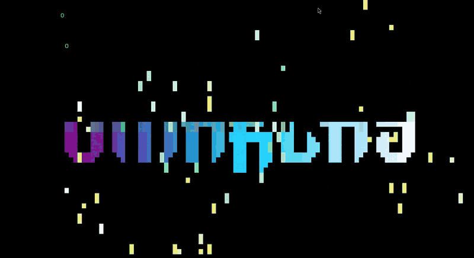
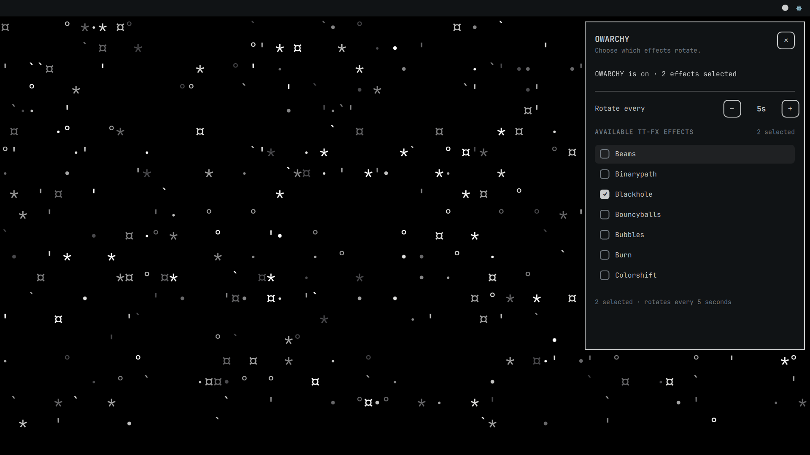

# OWARCHY

> The screensavers were dope as fuck, so I made them save my desktop. 😉

DHH pronounces Omarchy "Omachy," so of course I called this **OWARCHY**, pronounced **"owachy."** I'm warchin' the screensavers. You're warchin' the screensavers. Nobody's pronouncing the fucking R.

Omarchy has excellent taste in screensavers and a questionable policy of waiting until you stop using the computer to show them to you. I gave them the day shift.

OWARCHY runs Omarchy's actual `ttfx` screensaver effects as your desktop background, behind your windows. Now your inbox can have a black hole behind it. Finally, an accurate visual representation of email.

> **0.1.0 community preview:** Expect rough edges and check the requirements below. Omarchy plugins run with your user permissions, not in a sandbox; review the source before installing or enabling one.



## How to warch

- **Circle in the bar:** turn the animated background on or off.
- **Gear next to it:** open settings, pick your effects, and change the rotation interval.
- **One effect or a whole mix:** choose from the effects your installed `ttfx` provides. The default rotation interval is 45 seconds.
- **Had enough:** switch it off and your normal wallpaper comes back.

Fresh installs start **off**, with a few effects already selected. Your desktop doesn't get ambushed just because you installed a plugin. If you deselect every effect, the animation stays paused until you choose one.



## Requirements (yes, the wallpaper has dependencies)

On Arch/Omarchy, install the runtime and build dependencies with:

```sh
omarchy pkg add vte3 gtk-layer-shell python-gobject gtk3 wayland gcc make pkgconf ttfx
```

You'll need a Wayland Omarchy/Quickshell session to run it. The small C helper builds from the included source; there's no mystery binary from my laptop in the package. OWARCHY doesn't install system packages behind your back.

From a source checkout or the unpacked source archive:

```sh
make helper
make check
```

`make check` builds the helper and runs the Python package tests. `make clean` removes the generated helper and local Python bytecode caches.

## Install

Add the plugin **without `--enable`**. If Omarchy asks whether to enable the plugin during `add`, decline; build and validate it first.

```sh
omarchy plugin add https://github.com/dumpsteredition/owarchy.git
```

Omarchy installs the plugin under `$HOME/.config/omarchy/plugins`, even if you've set `XDG_CONFIG_HOME`. Build and validate that installed copy, review it, then enable it:

```sh
plugin_id='io.github.dumpsteredition.owarchy'
plugin_dir="$HOME/.config/omarchy/plugins/$plugin_id"

cd "$plugin_dir"
make helper
omarchy plugin validate "$plugin_dir"
# Review the source and build result before enabling.
omarchy plugin enable "$plugin_id"
```

Validation checks the manifest and entry-point layout. It doesn't build the helper or review the code's security.

## Update

Switch the plugin off before updating, then rebuild the helper and re-enable it. Same folder as before; `XDG_CONFIG_HOME` doesn't move Omarchy's plugin installation.

```sh
plugin_id='io.github.dumpsteredition.owarchy'
omarchy plugin disable "$plugin_id"
omarchy plugin update "$plugin_id"
plugin_dir="$HOME/.config/omarchy/plugins/$plugin_id"

cd "$plugin_dir"
make clean
make helper
omarchy plugin validate "$plugin_dir"
omarchy plugin enable "$plugin_id"
```

A plugin update is separate from any marketplace listing or review.

## Unwarch

You can turn the animation off with the bar's circle. To disable and remove the plugin entirely:

```sh
plugin_id='io.github.dumpsteredition.owarchy'
omarchy plugin disable "$plugin_id"
omarchy plugin remove "$plugin_id"
```

Your wallpaper survives the breakup. OWARCHY's settings stay too, in case this was just a rough patch.

### Where the settings live

OWARCHY uses `${XDG_CONFIG_HOME}/omarchy/owarchy.json` when `XDG_CONFIG_HOME` is absolute, or `$HOME/.config/omarchy/owarchy.json` otherwise. Unlike the plugin's installation folder, **the settings path does honor `XDG_CONFIG_HOME`.**

If you're sure you're done, remove only OWARCHY's settings and lock file after disabling/removing the plugin:

```sh
config_home="${XDG_CONFIG_HOME:-$HOME/.config}"
case "$config_home" in /*) ;; *) config_home="$HOME/.config" ;; esac
rm -f -- "$config_home/omarchy/owarchy.json" \
  "$config_home/omarchy/owarchy.json.lock"
```

The old local prototype used `screensaver-wallpaper.json`; OWARCHY doesn't import it automatically. To migrate manually, copy only the effect selections and rotation interval you want, keep `enabled` set to `false`, and don't overwrite existing `owarchy.json` settings. Disable the old prototype before enabling OWARCHY. We don't need two wallpapers fighting for custody of the desktop.

## Limits, before we get carried away

The animation loop targets 120 FPS. That isn't a promise of 120 displayed FPS; your machine, compositor, and selected effect still get a vote. There isn't a thermal-performance guarantee or multi-monitor certification. This is wallpaper, not a cooling system.

`make check` covers the source/package checks. It isn't a compositor-session or performance certification. This is a community preview. Bug reports from other setups are welcome; include your Omarchy version, display setup, and selected effect so we can reproduce the problem.

## Credit where it's due

The effects come from [`ttfx`](https://github.com/omacom-io/ttfx), the Rust port of [TerminalTextEffects](https://github.com/ChrisBuilds/terminaltexteffects). [Omarchy](https://github.com/omacom/omarchy) supplied the desktop and the reason I wanted to stare at it. OWARCHY gives those screensavers a bar switch and a job while you're still at the keyboard.

See [CREDITS.md](CREDITS.md) for the dependencies and [LICENSE](LICENSE) for OWARCHY's MIT license. Neither the name nor the missing R implies an official Omarchy endorsement.
